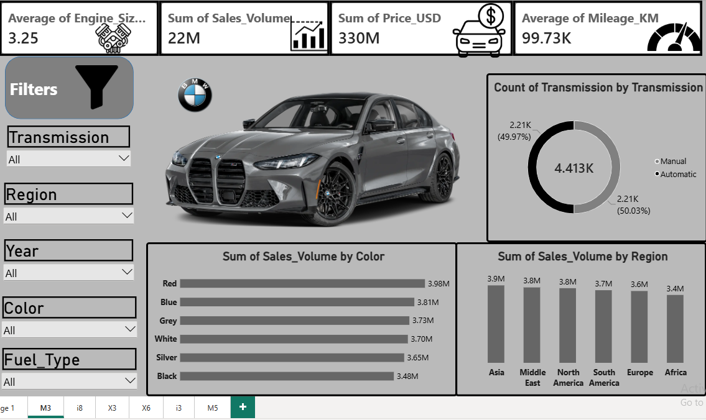
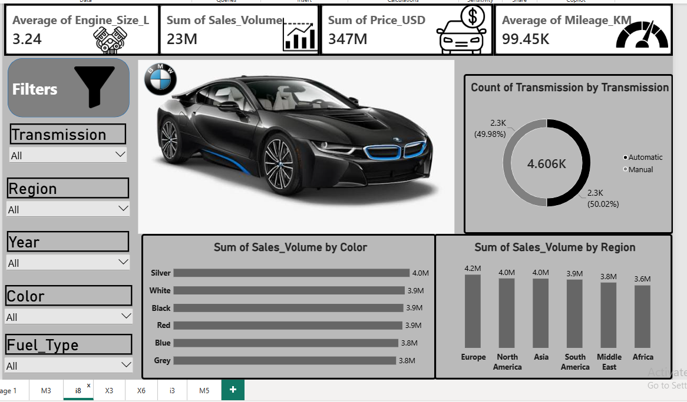
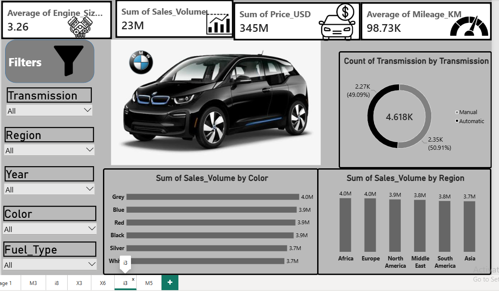

# 🚗 BMW Sales & Performance Analysis | Power BI

## 🎥 Project Demo

Explore my BMW dashboard project through this video demonstration on LinkedIn:

[▶ Watch the Full BMW Dashboard Demo](https://lnkd.in/p/dhRvu4d6)

## 📊 Dashboard Preview

### BMW M3

### BMW i8

### BMW M5

### BMW i3

### BMW X3

### BMW X6

## 🛠️ Tools & Technologies

- Microsoft Power BI
- DAX Measures
- Data Modeling
- Data Visualization
- Interactive Filters & Slicers

## 🎯 Project Objectives

- Analyze BMW performance across different car models.
- Track key performance indicators (KPIs).
- Identify trends and patterns in the data.
- Transform raw data into meaningful business insights.
- Support data-driven decision-making through interactive dashboards.

## 💡 Key Skills Demonstrated

- Data Analysis
- Business Intelligence
- Dashboard Development
- Analytical Thinking
- Data Visualization
  
## 📥 Download Power BI Project

[⬇️ Download BMW Power BI Dashboard (.pbix)](project.pbix)
---

*Turning data into insights and insights into better decisions.*
